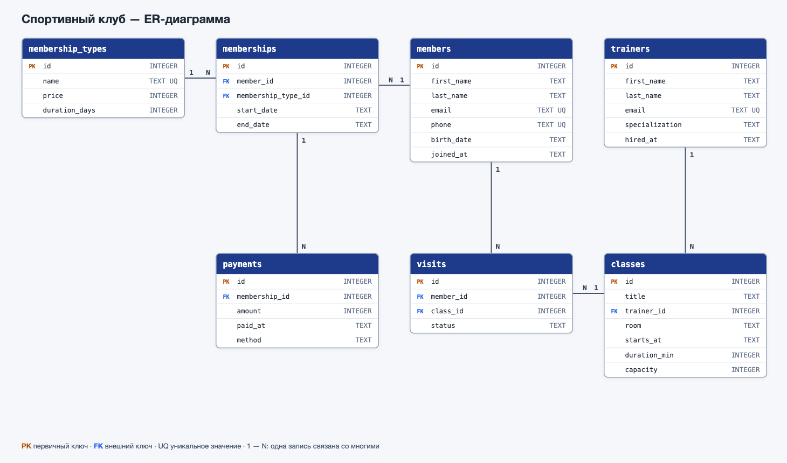
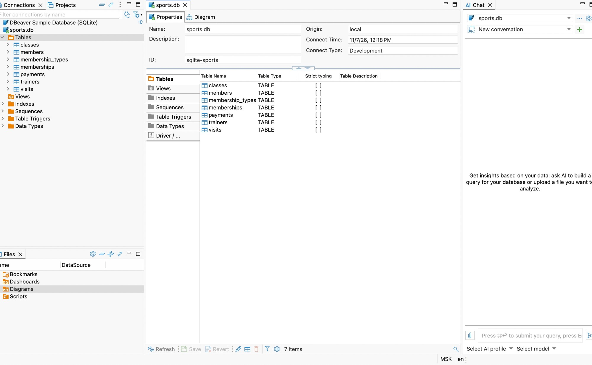
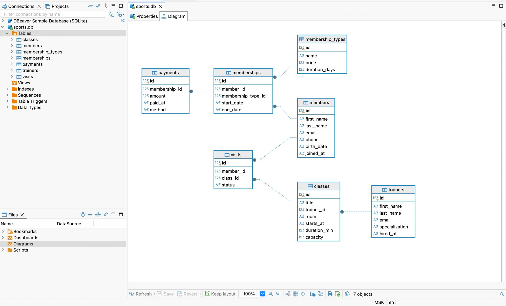
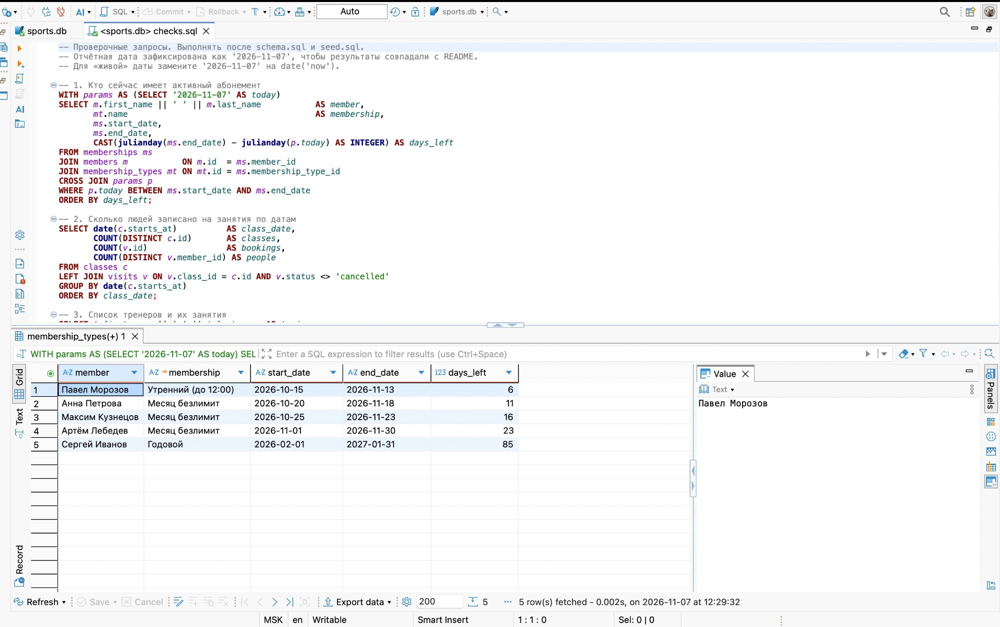
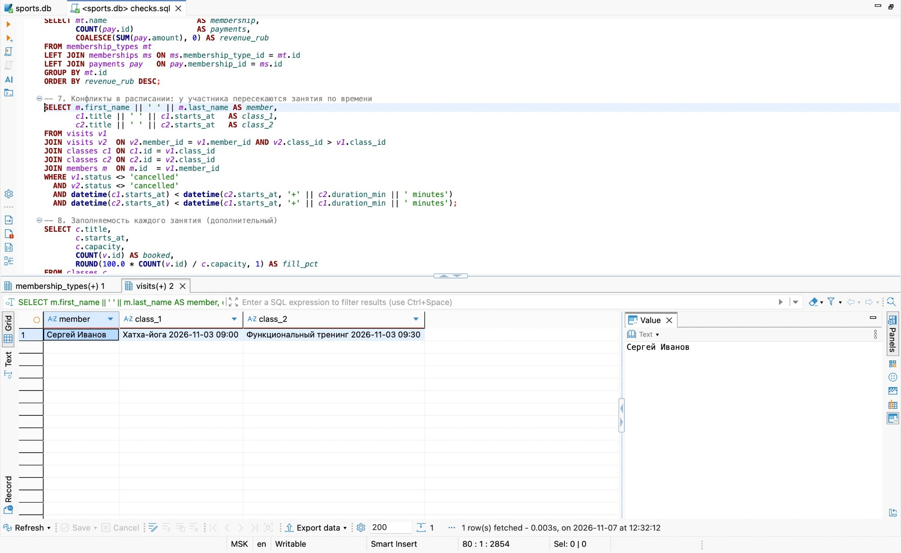

# База данных «Спортивный клуб» (SQLite)

## Таблицы

| Таблица | Зачем |
|---|---|
| `membership_types` | виды абонементов: название, цена, срок в днях |
| `members` | участники клуба: имя, e-mail, телефон, дата рождения, дата вступления |
| `trainers` | тренеры и их специализация |
| `classes` | занятия в расписании: тренер, зал, время начала, длительность, число мест |
| `memberships` | купленные абонементы: кто, какой вид, с какого по какое число |
| `payments` | оплаты абонементов: сумма, дата, способ оплаты |
| `visits` | записи и посещения: участник, занятие, статус (`booked`, `attended`, `no_show`, `cancelled`) |

Связи (1 — N):
- `trainers` → `classes`: у тренера много занятий;
- `members` → `memberships` и `membership_types` → `memberships`: у участника много абонементов во времени;
- `memberships` → `payments`: оплаты привязаны к абонементу;
- `members` → `visits` ← `classes`: многие ко многим через таблицу посещений.

## Ограничения

- `PRIMARY KEY` (`id`) в каждой таблице, `FOREIGN KEY` на все связи.
- `NOT NULL` на всех важных полях (имена, e-mail, даты, суммы, ссылки).
- `UNIQUE`: e-mail и телефон участника, e-mail тренера, название абонемента, пара (`member_id`, `class_id`) в `visits`, чтобы нельзя было записаться на одно занятие дважды.
- `CHECK`:
  - участнику не меньше 14 лет на дату вступления;
  - мест в группе больше 0, длительность занятия от 15 до 180 минут;
  - цена, срок абонемента и сумма оплаты больше 0;
  - дата окончания абонемента не раньше даты начала;
  - способ оплаты только `card`, `cash`, `transfer`, статус посещения только из списка;
  - e-mail похож на адрес (`%_@_%._%`).
- Индексы: `classes(trainer_id)`, `classes(starts_at)`, `memberships(member_id)`, `payments(membership_id)`, `visits(member_id)`, `visits(class_id)`.

Тестовые данные: 50 строк (3 вида абонементов, 8 участников, 3 тренера, 7 занятий, 8 абонементов, 8 оплат, 13 посещений).

## Проверочные запросы (`checks.sql`)

Отчётная дата в запросах зафиксирована как 2026-11-07, чтобы результат не менялся со временем.

1. Активные абонементы на сегодня и сколько дней осталось (5 человек).
2. Сколько людей записано на занятия по датам.
3. Тренеры и их занятия.
4. Кто не был в клубе больше 21 дня или не приходил ни разу (3 человека).
5. Топ-3 занятий по числу записей: хатха-йога, зумба, кроссфит.
6. Выручка по видам абонементов: годовой 78 000 ₽, месяц безлимит 17 550 ₽, утренний 6 000 ₽.
7. Конфликты расписания: Сергей Иванов записан на йогу в 09:00 и функциональный тренинг в 09:30 в один день.
8. Заполняемость каждого занятия в процентах.
9. Абонементы, которые закончатся в ближайшие 7 дней: кому напомнить о продлении.
10. Нагрузка тренеров: занятия, пришедшие, неявки.

## Как запустить

1. В DBeaver: «Новое подключение» → SQLite → создать файл `sports.db`.
2. Открыть SQL-редактор, выполнить `schema.sql` как скрипт (Alt+X).
3. Выполнить `seed.sql` как скрипт.
4. Выполнить `checks.sql`: каждый запрос откроется в своей вкладке результатов.

Готовая база тоже лежит в репозитории: `sports.db` можно просто открыть в DBeaver.

## Скриншоты из DBeaver

Таблицы базы:

ER-диаграмма, построенная DBeaver:

Запрос 1, активные абонементы:

Запрос 7, конфликты в расписании:

